# Manual de usuario

**Sistema Pinturas Liz · versión 0.7.0**

Este manual explica qué hace la aplicación, qué puede hacer cada perfil y cómo se hace cada tarea.
Corresponde a la versión que aparece en *Mi cuenta*. La historia completa de versiones está en
`HISTORIAL_VERSIONES.md`.

Dirección de la aplicación: **https://estadisticoj.github.io/pinturas-liz-app/**

---

## Novedades de esta versión (0.7.0)

- **Perfil Desarrollador:** puede todo lo que puede un socio y recibe las sugerencias de mejora.
- **Taller** ahora también despacha y marca *Entregado*. **Despacho** solo despacha y entrega.
- **Administración** también marca *Listo* y *Despacha*.
- **El vendedor:**
  - marca *Entregado* sus pedidos despachados y así puede cobrar contra entrega;
  - edita los datos de sus clientes.
- Todo cambio en clientes y precios llega a socios, Administración y Desarrollador como **Novedad**.
- En *Mi cuenta*:
  - **cambiar contraseña**;
  - **manual** y **guía rápida** del perfil;
  - **sugerir una mejora**.

---

## 1. Primeros pasos

### 1.1 Entrar

1. Abre la dirección de la aplicación en el celular o la computadora.
2. Escribe tu correo y tu contraseña y pulsa **Entrar**.
3. La primera vez, cambia la contraseña temporal: **Mi cuenta → Cambiar contraseña** (mínimo 8 caracteres).

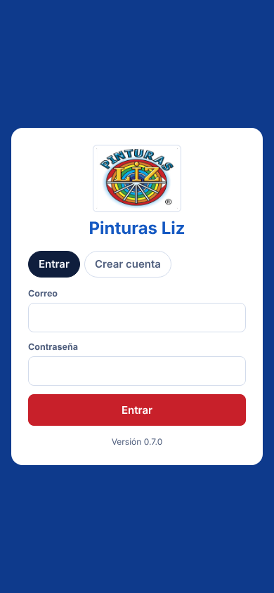

**Instalarla como app:** en el celular, abre el menú del navegador y elige *Agregar a la pantalla de inicio*.
Se abre como cualquier aplicación y **se actualiza sola**.

### 1.2 Partes de la pantalla

| Parte | Qué es |
| --- | --- |
| Barra azul superior | Logo, módulos (en computadora), **campana**, **Mi cuenta** y **carrito** |
| Franja roja (si aparece) | **Alerta urgente**: un pedido que debes revisar. Pulsa *Ver pedido* |
| Pestañas | Vistas del módulo (por ejemplo *Catálogo*, *Pedidos*, *Consolidado*) |
| Barra inferior (celular) | Módulos de tu perfil |
| Hoja lateral o inferior | Detalle de un pedido, producto, cliente o formulario |

### 1.3 Mi cuenta

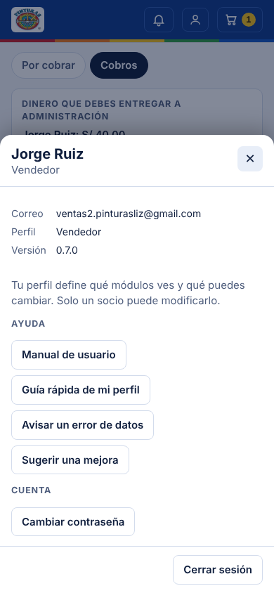

- **Manual de usuario** y **Guía rápida de mi perfil** (PDF).
- **Avisar un error de datos**: un dato falta o está mal (teléfono, precio, color…). Llega a los socios.
- **Sugerir una mejora**: una idea para la app. Llega al Desarrollador.
- **Cambiar contraseña**. Si la olvidas, pide a un socio o al Desarrollador que te pongan una nueva.
- **Administrar usuarios** (solo socios y Desarrollador).
- **Versión** de la aplicación.

### 1.4 La campana

El número amarillo suma tus **alertas** abiertas y las **novedades** que aún no viste.

- **Alertas**: datos que faltan o están mal, y pedidos en revisión. Cada una tiene comentarios.
- **Novedades** (socios, Administración y Desarrollador): clientes creados o cambiados, y precios
  nuevos, cambiados o quitados. Son solo informativas: **no hay que aprobar nada**.

---

## 2. Perfiles

| Perfil | Quién | Su trabajo en la app |
| --- | --- | --- |
| **Desarrollador** | Jordan Roldan | Todo lo del socio. Además recibe y evalúa las sugerencias de mejora y mantiene el sistema |
| **Socio** | Giovanni Escobedo, Liz Escobedo, Bryan Roldan | Acceso total. Solo socios y Desarrollador asignan perfiles, agregan medidas, fijan límites de crédito y resuelven alertas |
| **Administrativo** | Angelina Rodas | Controla pedidos, clientes y precios, confirma el dinero recibido y compra insumos y materiales |
| **Vendedor** | Lily De La Cruz, Jorge Ruiz | Registra pedidos de sus clientes, crea y edita sus clientes, pone el primer precio, entrega y cobra sus pedidos |
| **Taller** | Encargado Taller | Envasa, arma pedidos, pide producción al Laboratorio, despacha y entrega |
| **Despacho** | Encargado Despacho | Despacha y marca entregado |
| **Laboratorio** | Bryan Roldan (Laboratorio) | Fabrica lotes, los valida, los entrega al Taller y controla los insumos |

Una cuenta nueva queda **sin perfil** hasta que un socio o el Desarrollador se lo asigne.

## 3. Módulos

| Módulo | Para qué sirve | Lo usan |
| --- | --- | --- |
| **Pedidos** | Catálogo, carrito, pedidos con su estado, revisión y consolidado | Socio, Dev., Adm., Vendedor (solo los suyos), Taller, Despacho |
| **Clientes** | Ficha del cliente y sus precios por docena con historial | Socio, Dev., Adm., Vendedor |
| **Cobranzas** | Por cobrar, cobros con recibo, cuadre del dinero y deuda por cliente | Socio, Dev., Adm., Vendedor (solo lo suyo) |
| **Producción** | Órdenes, lotes, validación y entrega al Taller | Socio, Dev., Laboratorio |
| **Taller** | Por envasar, envasados, órdenes al Laboratorio y materiales por bolsa | Socio, Dev., Adm., Taller |
| **Almacén** | Existencias y movimientos de los 5 almacenes y mínimos | Cada perfil ve los suyos |
| **Campana** | Alertas y novedades | Todos (cada uno ve lo suyo) |
| **Usuarios** | Asignar perfiles y vincular vendedores (en *Mi cuenta*) | Socio, Dev. |

## 4. Qué puede hacer cada perfil

✔ = puede · — = no puede · *Soc./Dev.* = Socio y Desarrollador (mismos permisos)

**Ver no es modificar.** Por ejemplo, el Taller ve todos los pedidos, pero solo puede marcarlos *Listo*, despacharlos o
pedir una revisión.

### Pedidos

| Acción | Soc./Dev. | Adm. | Vendedor | Taller | Despacho | Lab. |
| --- | --- | --- | --- | --- | --- | --- |
| Registrar pedidos | ✔ | ✔ | ✔ | — | — | — |
| Ver pedidos | todos | todos | suyos | todos | todos | — |
| Modificar (antes del Taller) | ✔ | ✔ | suyos: *Recibido* o devueltos | — | — | — |
| Enviar a revisión | ✔ | ✔ | — | en *En taller* (va a Adm.) | — | — |
| «Corregido, reenviar» | ✔ | ✔ | suyos | — | — | — |
| Anular (hasta *En taller*) | ✔ | ✔ | — | — | — | — |
| Enviar al Taller | ✔ | ✔ | — | — | — | — |
| Marcar *Listo* | ✔ | ✔ | — | ✔ | — | — |
| Despachar | ✔ | ✔ | — | ✔ | ✔ | — |
| Marcar *Entregado* | ✔ | ✔ | suyos | ✔ | ✔ | — |
| Ver el consolidado | ✔ | ✔ | — | ✔ | — | — |

### Clientes y precios

| Acción | Soc./Dev. | Adm. | Vendedor | Taller | Despacho | Lab. |
| --- | --- | --- | --- | --- | --- | --- |
| Ver clientes | ✔ | ✔ | ✔ | en el pedido | en el pedido | — |
| Crear cliente | ✔ | ✔ | ✔ | — | — | — |
| Editar datos del cliente | ✔ | ✔ | sus clientes | — | — | — |
| Primer precio de un cliente | ✔ | ✔ | ✔ | — | — | — |
| Cambiar, programar o quitar un precio | ✔ | ✔ | — | — | — | — |
| Agregar una medida a un producto | ✔ | — | — | — | — | — |
| Fijar el límite de crédito | ✔ | — | — | — | — | — |
| Recibir novedades de clientes y precios | ✔ | ✔ | — | — | — | — |

### Cobranzas

| Acción | Soc./Dev. | Adm. | Vendedor | Taller | Despacho | Lab. |
| --- | --- | --- | --- | --- | --- | --- |
| Ver por cobrar y cobros | todo | todo | suyos | — | — | — |
| Registrar cobro o adelanto | ✔ | ✔ | suyos | — | — | — |
| Confirmar dinero recibido o anular un cobro | ✔ | ✔ | — | — | — | — |
| Ver deuda por cliente | ✔ | ✔ | — | — | — | — |

### Producción y Taller

| Acción | Soc./Dev. | Adm. | Vendedor | Taller | Despacho | Lab. |
| --- | --- | --- | --- | --- | --- | --- |
| Pedir producción al Laboratorio | ✔ | ✔ | — | ✔ | — | — |
| Registrar, validar y entregar lotes | ✔ | — | — | — | — | ✔ |
| Registrar envasados | ✔ | — | — | ✔ | — | — |
| Materiales por bolsa | ✔ | ✔ | — | ✔ | — | — |

### Almacén

| Almacén | Ven | Registran compras, salidas y ajustes |
| --- | --- | --- |
| Insumos | Soc./Dev., Adm., Lab. | Soc./Dev., Adm., Lab. |
| Granel Laboratorio | Soc./Dev., Adm., Lab. | Soc./Dev., Lab. |
| Granel Taller | Soc./Dev., Adm., Taller | Soc./Dev., Taller |
| Materiales | Soc./Dev., Adm., Taller | Soc./Dev., Adm., Taller |
| Producto envasado | Soc./Dev., Adm., Taller, Despacho | Soc./Dev., Taller |

### Campana y cuentas

| Acción | Soc./Dev. | Adm. | Vendedor | Taller | Despacho | Lab. |
| --- | --- | --- | --- | --- | --- | --- |
| Avisar un error o sugerir una mejora | ✔ | ✔ | ✔ | ✔ | ✔ | ✔ |
| Recibir alerta urgente de revisión | ✔ | ✔ | sus pedidos | — | — | — |
| Resolver alertas | ✔ | — | — | — | — | — |
| Ver novedades | ✔ | ✔ | — | — | — | — |
| Asignar perfiles y vincular vendedores | ✔ | — | — | — | — | — |
| Cambiar su propia contraseña | ✔ | ✔ | ✔ | ✔ | ✔ | ✔ |

---

## 5. Pedidos

### 5.1 Estados de un pedido

```
Recibido ──▶ En taller ──▶ Listo ──▶ Despachado ──▶ Entregado
   │  ▲          │
   ▼  │          ▼
 En revisión ◀───┘          (Anulado: desde Recibido, En revisión o En taller)
```

| Estado | Qué significa | Quién lo pasa al siguiente |
| --- | --- | --- |
| **Recibido** | Registrado; Administración lo revisa | Soc./Dev. o Adm. → *En taller* |
| **En revisión** | Hay que corregir algo (tiene un motivo) | Quien lo registró corrige y reenvía; Soc./Dev. o Adm. pueden enviarlo al Taller |
| **En taller** | Se está envasando y armando | Soc./Dev., Adm. o Taller → *Listo* |
| **Listo** | Armado y embolsado (sale del almacén de producto envasado) | Soc./Dev., Adm., Taller o Despacho → *Despachado* |
| **Despachado** | Salió hacia el cliente | Soc./Dev., Adm., Taller, Despacho o el vendedor del pedido → *Entregado* |
| **Entregado** | El cliente lo recibió; se puede cobrar | — |
| **Anulado** | Cancelado | — |

### 5.2 Registrar un pedido (Vendedor, Administración, Socio)

1. **Pedidos → Catálogo → Elegir cliente.** Busca por nombre, código o zona. *Mis clientes* muestra los tuyos.
   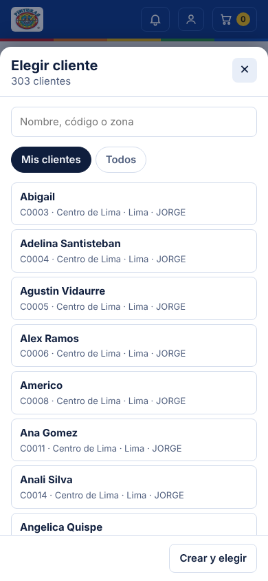 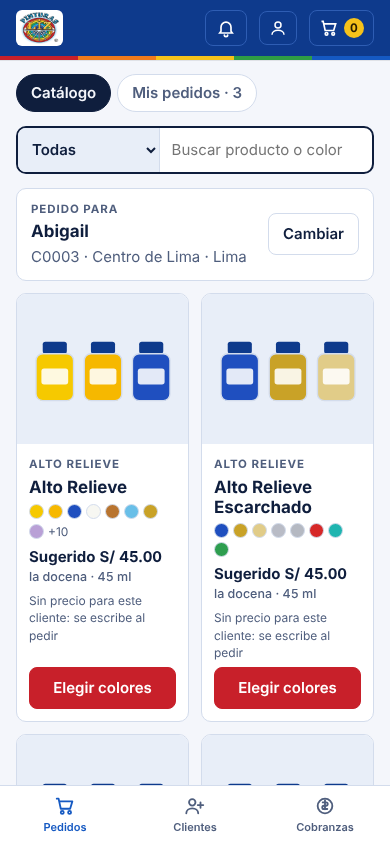
2. Abre un producto (**Elegir colores**):
   1. **Medida y precio por docena.** La medida *habitual* se elige sola. Si el cliente no tiene precio,
      escríbelo o pulsa **Usar sugerido** (el precio que más clientes pagan).
   2. **¿Docenas o unidades?** En *Docenas* cada + suma 12 frascos; en *Unidades*, uno. Se pueden mezclar colores:
      6 de Blanco y 6 de Negro.
   3. **Colores:** pulsa + en cada color. Abajo ves el total.
   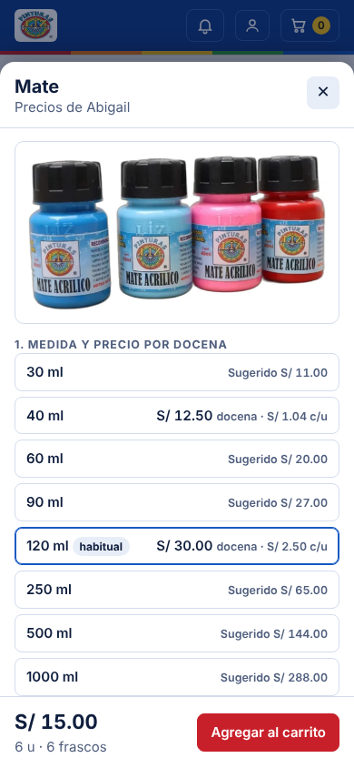 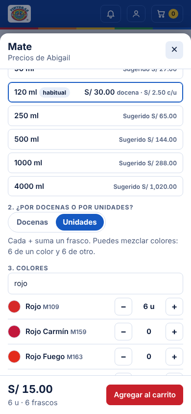
3. **Agregar al carrito.** Repite con otros productos.
4. **Carrito:** revisa cantidades, canal, fecha de entrega, **pago** y entrega.
   - **Contado:** se cobra al entregar.
   - **Crédito:** plazo de 7, 15 o 30 días, u **Otra fecha**.
   - **Adelanto:** el cliente paga antes; el adelanto se registra cuando el pedido pasa al Taller.
   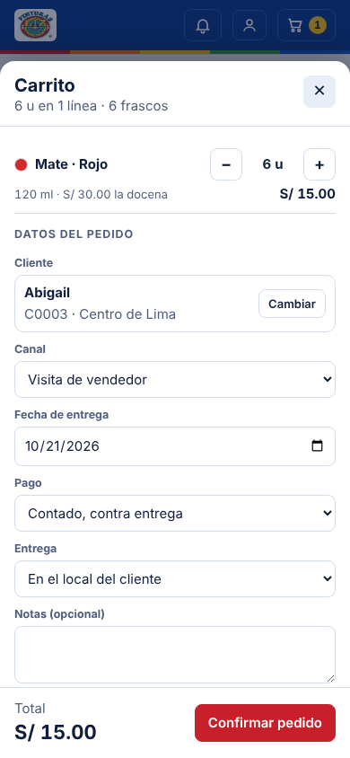
5. **Confirmar pedido.** Queda *Recibido* con su número (P-00001…).

**Precio por unidad:** el precio es por docena; un frasco cuesta la docena ÷ 12.
Ejemplo: Mate 120 ml a S/ 30 la docena → 6 unidades = S/ 15.

**Empaque:** el pedido muestra cómo lo arma el Taller. Los colores de un mismo producto y medida se juntan en bolsas de
**12** (hasta 120 ml) o de **6** (250 ml), y lo que sobra va en una bolsa aparte.

### 5.3 Modificar un pedido

- **Quién y cuándo:**
  - Socio, Desarrollador y Administración, mientras esté *Recibido* o *En revisión*.
  - Quien lo registró, mientras esté *Recibido* o cuando se lo devuelvan a revisión.
- **Cómo:** abre el pedido → **Modificar**. El carrito muestra el pedido y puedes cambiar cantidades, agregar
  productos desde el catálogo o cambiar los datos. **Guardar cambios**.
- Las líneas que quedan **conservan su precio**. Cada cambio queda en el *Seguimiento*.

### 5.4 Revisión

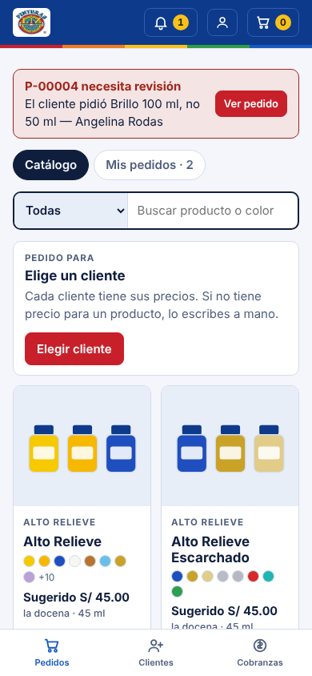 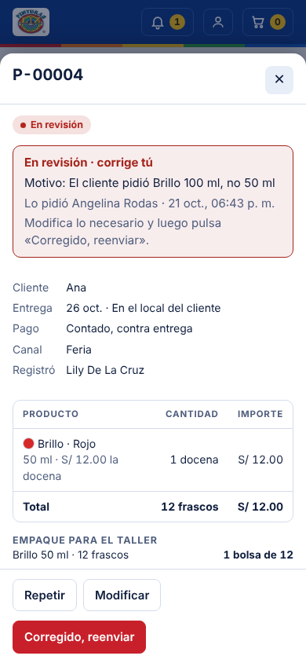

- **Socio, Desarrollador o Administración:** abren el pedido → **Enviar a revisión** → escriben el motivo.
- **Taller:** en un pedido *En taller* → **Enviar a revisión**. Lo ve primero Administración, que puede corregirlo,
  devolverlo a quien lo registró o enviarlo de nuevo al Taller.
- **Quien debe corregir:**
  1. Ve la **franja roja** arriba de la pantalla.
  2. Pulsa *Ver pedido* → **Modificar** → **Guardar cambios**.
  3. Pulsa **Corregido, reenviar**.
- Los pedidos en revisión **no se suman** al consolidado del Taller.

### 5.5 Repetir y anular

- **Repetir:** copia los productos de un pedido al carrito, con los precios actuales del cliente.
- **Anular:** Socio, Desarrollador o Administración, hasta *En taller*. Pide confirmación.

---

## 6. Clientes y precios

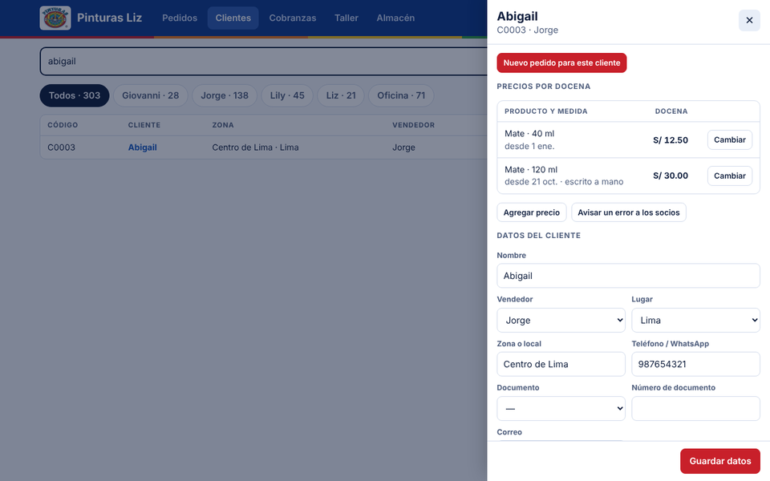

- **Ficha del cliente:** sus precios por docena, precios programados, historial y datos (teléfono, documento,
  dirección, agencia, pago habitual).
  - El vendedor edita los datos de **sus** clientes.
  - Socios, Desarrollador y Administración, los de todos.
- **Crear cliente:** desde *Elegir cliente → Cliente nuevo* o desde Clientes. Recibe código (C0001…) y queda a nombre
  del vendedor que lo creó.
- **Precios:**
  - Siempre **por docena** y **de cada cliente**; no hay lista general.
  - **Primer precio:** se escribe en el pedido o con *Agregar precio* (Socio, Dev., Adm. y Vendedor).
  - **Cambiar un precio:** se elige desde qué fecha rige, y el anterior queda en el historial (Socio, Dev. y Adm.).
    Se puede programar un alza.
  - **Quitar un precio:** desde mañana ese producto se pide a mano.
  - **Medida nueva** (por ejemplo, la primera de un producto sin precio): solo Socio o Desarrollador.
  - Los pedidos ya registrados **no cambian** si después cambia el precio.
- **Novedades:** cada cliente nuevo, cada cambio de datos y cada precio nuevo, cambiado o quitado llega a Socio,
  Desarrollador y Administración, con quién lo hizo y el valor anterior.

## 7. Cobranzas

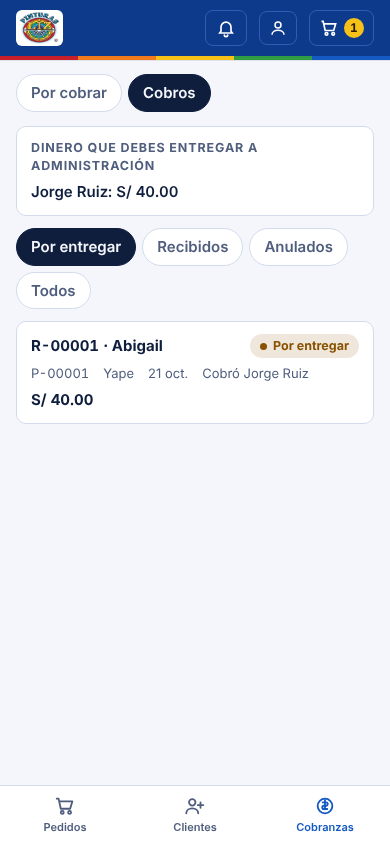 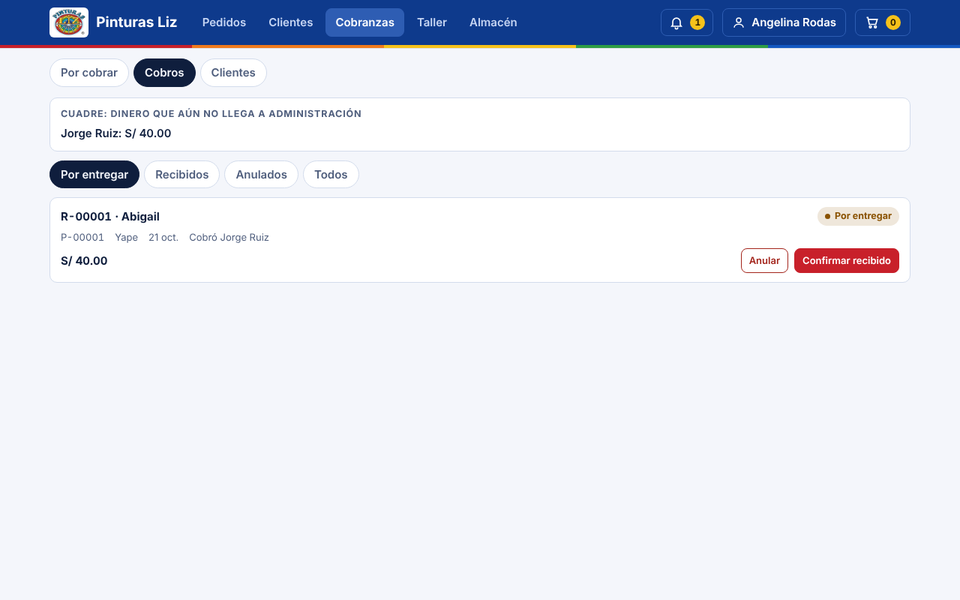

| Forma de pago | Cuándo se registra el cobro |
| --- | --- |
| Contado (contra entrega) | Cuando el pedido está **Entregado**. El vendedor puede marcar *Entregado* sus pedidos y luego cobrar |
| Crédito | Cuando está **Entregado**; vence según el plazo o la fecha elegida |
| Adelanto | Desde que el pedido pasa al **Taller** |

1. **Registrar cobro:** desde *Por cobrar* o desde el pedido. Monto, medio (efectivo, Yape, Plin, transferencia,
   depósito) y fecha. Se genera un recibo (R-00001…).
2. **Cuadre:** el cobro queda *Por entregar* hasta que Administración confirma que recibió el dinero (**Confirmar
   recibido**). Arriba se ve cuánto debe entregar cada persona.
3. **Clientes:** deuda, deuda vencida y límite de crédito (lo fija un socio).

## 8. Producción (Laboratorio)

1. **Órdenes:** el Taller o Administración piden producción (color y litros). El Laboratorio las ve en *Órdenes*.
2. **Registrar lote:** color, litros e insumos usados (salen del almacén de Insumos).
3. **Validar:** viscosidad, transparencia y color. Si se aprueba, el lote entra a **Granel Laboratorio**.
4. **Entregar al Taller:** pasa a **Granel Taller** y la orden queda atendida.

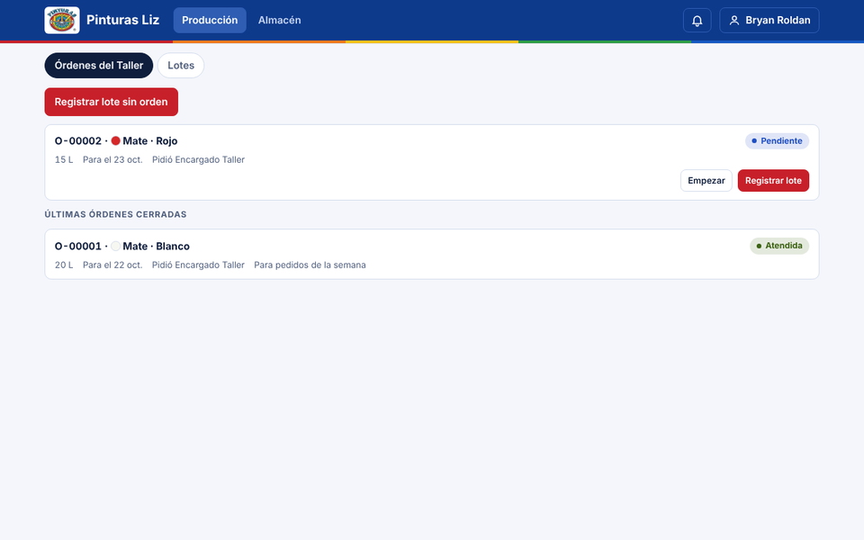 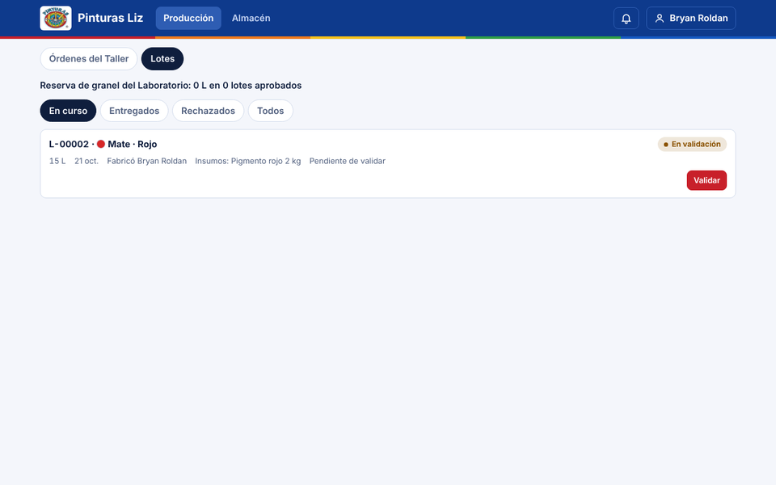

## 9. Taller

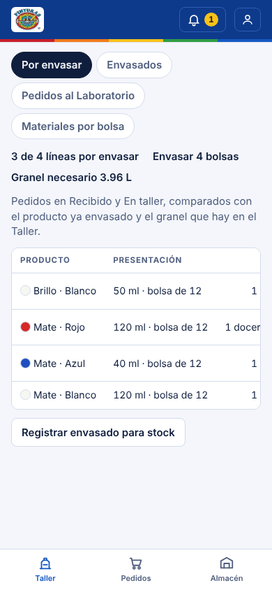 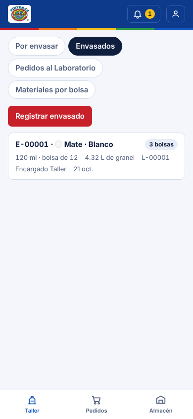

- **Por envasar:** lo que piden los pedidos (*Recibido* y *En taller*) frente a lo ya envasado. Indica cuántas
  **bolsas** llenar y cuánto granel hace falta.
- **Registrar envasado** (Taller): color, medida y bolsas llenas. Descuenta granel y materiales, y suma frascos al
  producto envasado.
- **Pedidos al Laboratorio:** nueva orden de producción cuando falta granel.
- **Materiales por bolsa:** cuántos frascos, tapas, etiquetas y bolsas consume cada bolsa envasada.
- **En Pedidos:**
  - **Marcar listo** (descuenta el producto envasado);
  - **Despachar** y **Marcar entregado**;
  - **Enviar a revisión** si hay un problema.

## 10. Despacho

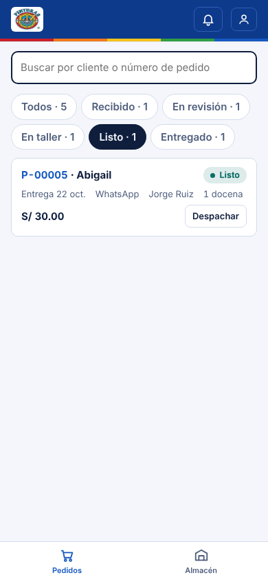 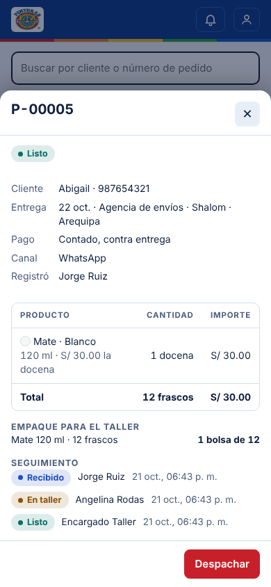

1. **Pedidos** se abre en los pedidos **Listos**.
2. Abre el pedido: ve el cliente, la entrega o agencia, y el empaque → **Despachar**.
3. Al entregarlo → **Marcar entregado**.

## 11. Almacén

Cinco almacenes:

| Almacén | Unidad | Se mueve solo cuando… |
| --- | --- | --- |
| Insumos | kg, L… | el Laboratorio registra un lote (salida) |
| Granel Laboratorio | L | se aprueba un lote (entrada) o se entrega al Taller (salida) |
| Granel Taller | L | el Laboratorio entrega (entrada) o el Taller envasa (salida) |
| Materiales | und… | el Taller envasa (salida según materiales por bolsa) |
| Producto envasado | frascos | el Taller envasa (entrada) o un pedido queda *Listo* (salida) |

A mano se registran **compras**, **salidas** (merma) y **ajustes por conteo**. Los movimientos no se borran.
Con un **mínimo**, el almacén avisa cuando la existencia baja de ese número.

## 12. Usuarios (Socio y Desarrollador)

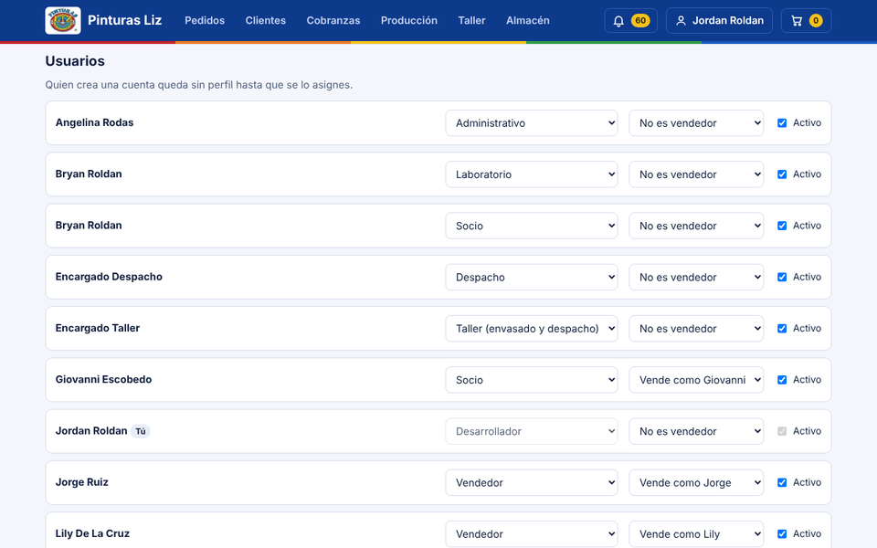

**Mi cuenta → Administrar usuarios:**
- asignar el perfil;
- vincular al vendedor con su nombre de la lista de clientes («Vende como»);
- activar o desactivar la cuenta.

Nadie puede quitarse su propio perfil de socio o desarrollador.

---

## 13. Preguntas frecuentes

**No veo un botón que otro compañero sí ve.** Cada perfil ve solo lo que puede hacer (sección 4).

**Dice «Tu perfil no tiene permiso».** La acción no corresponde a tu perfil. Si crees que es un error, usa *Avisar un error*.

**No puedo registrar el cobro.** Contado y crédito se cobran cuando el pedido está **Entregado**; el adelanto, desde
que pasa al Taller.

**El producto dice «Sin precio».** El cliente aún no tiene precio para esa medida: escríbelo o usa el sugerido.

**Un producto no aparece en el catálogo.** No tiene medidas; un socio debe agregarlas.

**La app no muestra lo último.** Cierra y vuelve a abrir la app; se actualiza sola. La versión está en *Mi cuenta*.

**Olvidé mi contraseña.** Pide a un socio o al Desarrollador que te pongan una nueva y cámbiala al entrar.

## 14. Glosario

| Término | Significado |
| --- | --- |
| Docena / unidad | 12 frascos / 1 frasco. El precio siempre es por docena |
| Bolsa | Paquete del Taller: 12 frascos (hasta 120 ml) o 6 (250 ml) |
| Precio sugerido | El precio por docena que más clientes pagan hoy por ese producto y medida |
| Medida habitual | La medida de un producto que más clientes compran |
| Granel | Pintura fabricada, aún sin envasar (en litros) |
| Lote | Una producción del Laboratorio (L-00001…) |
| Orden | Pedido de producción del Taller al Laboratorio (O-00001…) |
| Envasado | Registro de bolsas llenadas por el Taller (E-00001…) |
| Recibo | Comprobante interno de un cobro (R-00001…) |
| Novedad | Aviso informativo de clientes o precios nuevos o cambiados |
| Alerta | Dato faltante, error o pedido en revisión, con comentarios |
